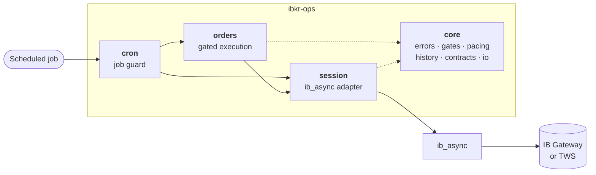
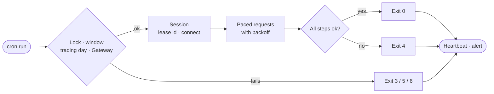
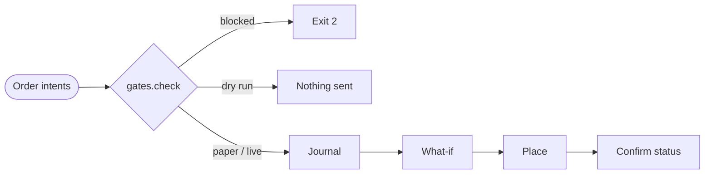

<div align="center">

<picture>
  <source media="(prefers-color-scheme: dark)" srcset="https://raw.githubusercontent.com/daniel-debrun/ibkr-ops/main/docs/assets/banner-dark.svg">
  
</picture>

<br/>

[](https://github.com/daniel-debrun/ibkr-ops/actions/workflows/tests.yml)


[](https://github.com/daniel-debrun/ibkr-ops/blob/main/LICENSE)

**Pre-trade order gates, request pacing, client-id leasing and a scheduled-job guard for running Interactive Brokers workloads unattended.**

[Features](#features) · [Installation](#installation) · [Quick start](#quick-start) · [How it works](#how-it-works) · [Documentation](#documentation)

</div>

> [!WARNING]
> Not affiliated with, endorsed by, or supported by Interactive Brokers. Trading software can cause financial loss. This software is provided "as is", without warranty of any kind (see [LICENSE](https://github.com/daniel-debrun/ibkr-ops/blob/main/LICENSE)). Validate all workflows against a paper account.

## Contents

- [Overview](#overview)
- [Features](#features)
- [Installation](#installation)
- [Quick start](#quick-start)
- [How it works](#how-it-works)
  - [Architecture](#architecture)
  - [Scheduled job flow](#scheduled-job-flow)
  - [Order execution flow](#order-execution-flow)
- [Exit codes](#exit-codes)
- [Command-line interface](#command-line-interface)
- [Documentation](#documentation)
- [Development](#development)
- [License](#license)

## Overview

[ib_async](https://github.com/ib-api-reloaded/ib_async) provides the Interactive Brokers client. **ibkr-ops** adds the controls needed to run it without supervision and replaces several ib_async defaults with stricter behaviour:

| Area | ib_async default | ibkr-ops |
|---|---|---|
| Request errors | Completed with an empty result | Raised as typed errors; only "no data" returns `[]` |
| History timeouts | Empty list returned | `TimeoutError` raised, so backoff applies |
| Read-only mode | `placeOrder` still transmits | Read-only by default; order calls refused |
| Contract qualification | Lookups issued concurrently | Serialised per process |
| Order code 321 | Order left in an active state | Reported as `Rejected` |
| End anchors | `date` interpreted as local time | Explicit UTC strings |
| Client ids | Caller-supplied | Leased per role; retried on 326 |

## Features

<table>
<tr>
<td width="50%" valign="top">

**Order gates**<br/>
Dry run by default; paper-only unless live trading is explicitly authorised; kill switch; per-order, per-batch and daily caps; allowlists; fresh live reference quotes; bounded limit prices; idempotency keys; IB what-if checks; append-only ledger.

</td>
<td width="50%" valign="top">

**Scheduled-job guard**<br/>
Locking, UTC logging, Gateway pre-flight, schedule-window validation, step isolation, defined exit codes, heartbeats and alerting.

</td>
</tr>
<tr>
<td valign="top">

**Request pacing**<br/>
IB's historical-data limits (60 per 10 min, 15 s identical, 6 per 2 s per contract) with backoff on pacing errors and timeouts.

</td>
<td valign="top">

**Session**<br/>
Read-only by default, typed errors, serialised contract lookups, client-id leasing, immediate Gateway-down detection, connectivity tracking.

</td>
</tr>
<tr>
<td valign="top">

**Data utilities**<br/>
Sentinel normalisation, live/delayed quote tagging, history request planning, contract caching with negative results, NYSE trading calendar.

</td>
<td valign="top">

**Deployment references**<br/>
Crontab and systemd timer templates, a hard-timeout shell wrapper, and Gateway keep-alive via IBC and ib_async's Watchdog.

</td>
</tr>
</table>

## Installation

Requires Python 3.10+ and IB Gateway or TWS with the API enabled.

```bash
pip install ibkr-ops                  # installs ib_async 2.1.x
pip install "ibkr-ops[signing]"       # optional: signed order inputs (PyNaCl)
```

## Quick start

A read-only quote job under the scheduled-job guard:

```python
import sys

from ibkr_ops import cron
from ibkr_ops.contracts import to_contract
from ibkr_ops.session import Session


def main(job: cron.Job) -> None:
    with Session(role="cron-quotes") as session:          # read-only by default
        job.step("quotes", session.quotes, {"SPY": to_contract("SPY")})


sys.exit(cron.run("spy-quotes", main, trading_day=True, window=("19:50Z", 70)))
```

Placing orders through the gates:

```python
from ibkr_ops import gates, orders
from ibkr_ops.session import Session

policy = gates.Policy(place=True, max_order_value=5_000)       # paper accounts only
intents = [gates.OrderIntent("SPY", qty=10, limit=501.25, ref_price=501.10,
                             quote_at=quote_time, price_type="live", idem_key="signal-42:SPY")]

with Session(role="cron-orders", readonly=False) as session:
    decision, results = orders.execute(session, intents, policy, ledger="state/orders.jsonl")
```

Live accounts additionally require `Policy(allow_live=True)` and `IBKR_ALLOW_LIVE=1`. See [`examples/`](https://github.com/daniel-debrun/ibkr-ops/tree/main/examples) for complete jobs.

## How it works

### Architecture



### Scheduled job flow



### Order execution flow



Detailed diagrams, covering client-id retry, pacing backoff, rejection handling and heartbeat monitoring, are in [docs/flows.md](https://github.com/daniel-debrun/ibkr-ops/blob/main/docs/flows.md).

## Exit codes

| Code | Meaning | Alert |
|:---:|---|:---:|
| `0` | Success | |
| `1` | Unhandled error | ✓ |
| `2` | Refused (gates, kill switch, signature verification) | |
| `3` | Gateway unavailable | ✓ |
| `4` | Partial failure | ✓ |
| `5` | Skipped (lock held, or not a trading day) | lock only |
| `6` | Misfired (started outside its declared window) | ✓ |

## Command-line interface

```bash
python -m ibkr_ops probe [--handshake]            # Gateway availability (exit 0 up, 3 down)
python -m ibkr_ops heartbeats JOB=HOURS ... [--alert]
python -m ibkr_ops code CODE [MESSAGE]            # classify an IB error code
python -m ibkr_ops holidays YEAR                  # NYSE holidays
```

No command places orders.

## Documentation

| Document | Contents |
|---|---|
| [Architecture](https://github.com/daniel-debrun/ibkr-ops/blob/main/docs/architecture.md) | Layering, behaviour relative to ib_async, error model, state |
| [Flows](https://github.com/daniel-debrun/ibkr-ops/blob/main/docs/flows.md) | Detailed scheduled-job, order-execution and heartbeat diagrams |
| [Order safety](https://github.com/daniel-debrun/ibkr-ops/blob/main/docs/order-safety.md) | Policy reference, checks, execution sequence, ledger, signed inputs |
| [Operations](https://github.com/daniel-debrun/ibkr-ops/blob/main/docs/operations.md) | Gateway configuration, scheduling, heartbeats, client ids, environment variables |
| [IB API reference](https://github.com/daniel-debrun/ibkr-ops/blob/main/docs/ib-api-reference.md) | Error codes, pacing, market data, contracts, ForecastEx, orders |
| [Changelog](https://github.com/daniel-debrun/ibkr-ops/blob/main/CHANGELOG.md) | Release history |

## Development

```bash
python -m venv .venv
.venv/bin/pip install -e ".[test]"
.venv/bin/python -m pytest
```

The test suite requires no Gateway: [`tests/fake_ib.py`](https://github.com/daniel-debrun/ibkr-ops/blob/main/tests/fake_ib.py) emulates `ib_async.IB` using ib_async's own data types.

## License

Released under the [MIT License](https://github.com/daniel-debrun/ibkr-ops/blob/main/LICENSE). ib_async is distributed under the BSD 2-Clause License.
