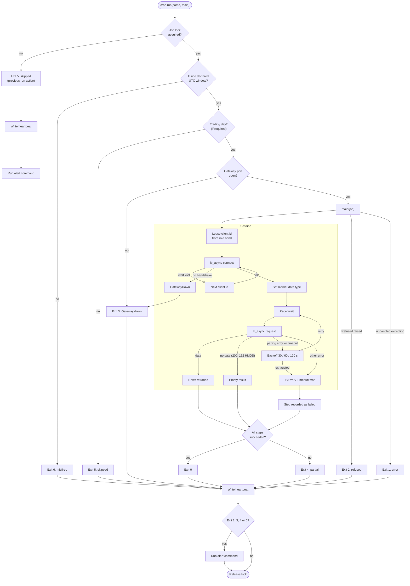
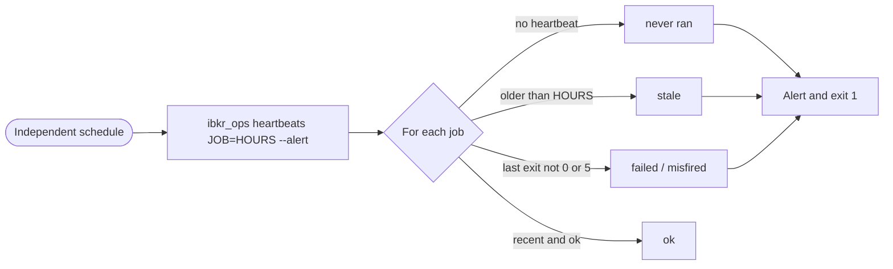
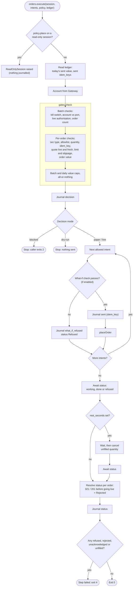

# Flows

## General flow: scheduled job

A job run under `cron.run`, opening a `Session` and issuing paced requests. Exit codes are listed in [operations.md](operations.md#job-guard).

Missed runs leave no heartbeat, so an independent schedule checks for them:

## Special flow: order execution

`orders.execute` for a batch of order intents. Every refusal is journalled before the flow stops.

